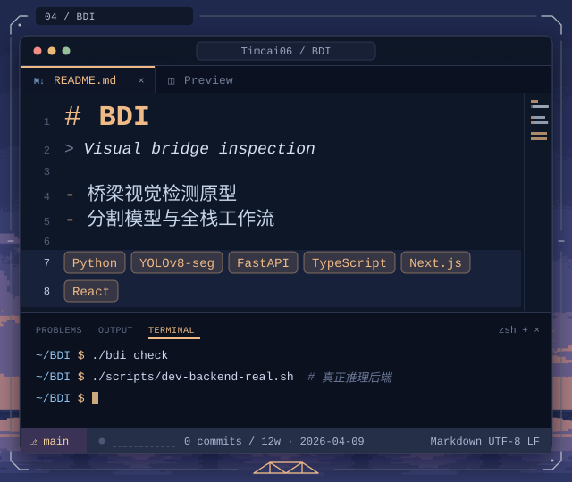
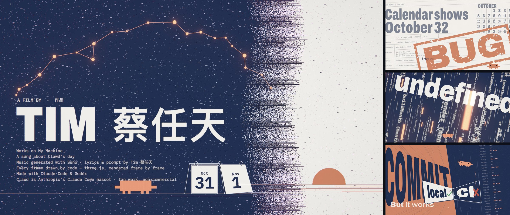
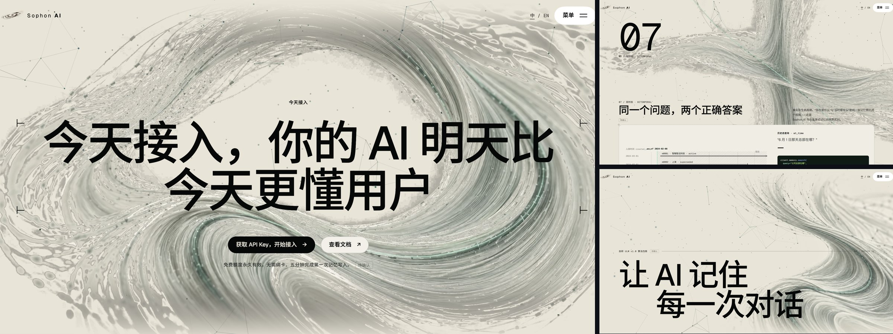

  <picture>
    <source media="(prefers-color-scheme: dark)" srcset="https://readme-typing-svg.demolab.com/?font=JetBrains+Mono&amp;weight=600&amp;size=30&amp;duration=1800&amp;pause=1000&amp;color=79C0FF&amp;center=true&amp;vCenter=true&amp;repeat=false&amp;letterSpacing=1px&amp;width=540&amp;lines=Hi%2C+I'm+Tim+Cai">
    <source media="(prefers-color-scheme: light)" srcset="https://readme-typing-svg.demolab.com/?font=JetBrains+Mono&amp;weight=600&amp;size=30&amp;duration=1800&amp;pause=1000&amp;color=0969DA&amp;center=true&amp;vCenter=true&amp;repeat=false&amp;letterSpacing=1px&amp;width=540&amp;lines=Hi%2C+I'm+Tim+Cai">
    
  </picture>

  
  

  <picture>
    <source media="(prefers-color-scheme: dark)" srcset="https://readme-typing-svg.demolab.com/?font=JetBrains+Mono&amp;weight=500&amp;size=18&amp;duration=3000&amp;pause=900&amp;color=79C0FF&amp;center=true&amp;vCenter=true&amp;width=760&amp;lines=Building+evidence-grounded+AI+systems;Designing+ML+tools+you+can+inspect;Turning+experiments+into+useful+products">
    <source media="(prefers-color-scheme: light)" srcset="https://readme-typing-svg.demolab.com/?font=JetBrains+Mono&amp;weight=500&amp;size=18&amp;duration=3000&amp;pause=900&amp;color=0969DA&amp;center=true&amp;vCenter=true&amp;width=760&amp;lines=Building+evidence-grounded+AI+systems;Designing+ML+tools+you+can+inspect;Turning+experiments+into+useful+products">
    
  </picture>

<a href="#featured"><b>重点作品</b></a> &nbsp;·&nbsp; <a href="#code-in-motion"><b>用代码做动画</b></a> &nbsp;·&nbsp; <a href="#toolbox"><b>技术栈</b></a> &nbsp;·&nbsp; <a href="#more"><b>更多项目与数学建模</b></a>

<b>Hi, I'm Tim, a student developer based in Shanghai.</b>

I focus on <code>AI agents</code>, <b>observability for ML / DL / RL</b>, quantitative research systems, and <b>carefully crafted full-stack products</b>. I enjoy following an idea all the way through: from models and data pipelines to the interface someone actually uses.

Full-stack is central to how I learn and build. My interests span frontend, backend, databases, LLMs, AI infrastructure, and lower-level computing systems. I work with React, Next.js and FastAPI, build around PostgreSQL and Redis, and explore GSAP motion and Three.js experiences. I'm working toward becoming a versatile, end-to-end developer in the AI era.

<b>你好，我是 Tim，一名在上海学习的学生开发者。</b>

我专注于<code>智能体开发</code>、<b>ML / DL / RL 的可观测性工具</b>、量化研究系统，以及<b>经过细致打磨的全栈产品</b>。我喜欢沿着一个想法往下走：从模型、数据流和后端逻辑，一直做到用户真正接触的界面。

全栈是我的标签：从前端到后端、数据库，再到 LLM、AI infrastructure 和计算机底层；从 GSAP 高级前端动效、Three.js 3D 体验到 React 开发；从 FastAPI、Next.js 到 Redis、PostgreSQL。我希望成为 AI 时代能够端到端解决问题的开发者，也在持续把实验转化为可以理解、观察和使用的产品。

<blockquote>

<b>Now / 近期关注</b> Evidence-grounded research workflows, local-first ML tooling, and systems that turn experiments into usable products. 有证据支撑的研究工作流、本地优先的机器学习工具，以及将实验转化为可用产品的系统。

</blockquote>

<h2 id="featured">重点作品 Featured work</h2>
<table>
<tr>
<td width="50%" valign="top">

<h3><a href="https://github.com/Timcai06/TTT-I-M">TTT-I-M</a> 个人网站与内容工作室</h3>

我的个人网站与内容工作室：<b>电影感 Landing</b> 与博客、作品、内容管理组成同一套空间。探索 GSAP 动效、Three.js / React Three Fiber 与全栈内容系统如何共同服务个人表达。

      

<a href="https://github.com/Timcai06/TTT-I-M"><kbd>仓库 / Repo ↗</kbd></a> <a href="https://www.crt-dsg.com"><kbd>crt-dsg.com ↗</kbd></a>

</td>
<td width="50%" valign="top">

<h3><a href="https://github.com/Timcai06/BDI">BDI</a> 桥梁视觉检测</h3>

无人机桥梁巡检原型：把 <b>YOLOv8-seg 病害分割</b>接入全栈工作流，围绕检测结果与本地产物提供可查看的界面。

     

<a href="https://github.com/Timcai06/BDI"><kbd>仓库 / Repo ↗</kbd></a>

</td>
</tr>
</table>

<table>
<tr>
<td width="44%" valign="middle"></td>
<td width="56%" valign="middle">
<h3><a href="https://github.com/Timcai06/SciScope">SciScope</a> Evidence-grounded research</h3>

围绕文献与证据构建研究工作流，让检索、阅读与研究过程<b>有据可循</b>。Python RAG 后端配合 Go TUI，把研究能力带到终端。

      

</td>
</tr>
<tr>
<td width="44%" valign="middle"></td>
<td width="56%" valign="middle">
<h3><a href="https://github.com/Timcai06/EduCanvas">EduCanvas</a> A personal agent for learning</h3>

<b>以教育能力为核心的通用个人 Agent 平台</b>。用 Notebook 组织文档、对话、Canvas 与学习过程，在统一运行时里组合工具和技能。

      

</td>
</tr>
<tr>
<td width="44%" valign="middle"></td>
<td width="56%" valign="middle">
<h3><a href="https://github.com/Timcai06/PulseGraph">PulseGraph</a> See what your training is doing</h3>

<b>本地优先</b>的 PyTorch 训练可观测性工作台：连接模型图、训练指标、检查点与推理回放，让实验过程更容易检查和追溯。

      

</td>
</tr>
</table>

<h2 id="code-in-motion">用代码做动画 Code in motion</h2>

<b>用代码编排场景、镜头与时间，<code>把程序变成动画</code>。</b> 
Scenes, cameras and time, composed in code.

<blockquote>
这是一个持续创作的系列，新作品完成后会收录在这里。
</blockquote>
<table>
<tr>
<td>

<h3><kbd>01</kbd> &nbsp;<a href="https://github.com/Timcai06/clawd-mv">clawd-mv</a> Works on My Machine</h3>

代码驱动的音乐影像实验，用 TypeScript / Three.js 时间轴与离线渲染串起场景、镜头和音乐。基于 pdoom-video 开源框架进行个人非商业创作，目前持续迭代中。

      

</td>
</tr>
</table>

<h2 id="toolbox">技术栈 Toolbox</h2>
<table>
<tr>
<td width="170" valign="middle"><b>语言</b> Languages</td>
<td><picture><source media="(prefers-color-scheme: dark)" srcset="https://skillicons.dev/icons?i=py%2Cts%2Cjs%2Cgo&amp;theme=dark"><source media="(prefers-color-scheme: light)" srcset="https://skillicons.dev/icons?i=py%2Cts%2Cjs%2Cgo&amp;theme=light"></picture></td>
</tr>
<tr>
<td valign="middle"><b>AI 与研究</b> AI &amp; research</td>
<td><picture><source media="(prefers-color-scheme: dark)" srcset="https://skillicons.dev/icons?i=pytorch&amp;theme=dark"><source media="(prefers-color-scheme: light)" srcset="https://skillicons.dev/icons?i=pytorch&amp;theme=light"></picture> 
   </td>
</tr>
<tr>
<td valign="middle"><b>前端与动效</b> Web &amp; motion</td>
<td><picture><source media="(prefers-color-scheme: dark)" srcset="https://skillicons.dev/icons?i=react%2Cnextjs%2Cvite%2Ctailwind%2Cthreejs&amp;theme=dark"><source media="(prefers-color-scheme: light)" srcset="https://skillicons.dev/icons?i=react%2Cnextjs%2Cvite%2Ctailwind%2Cthreejs&amp;theme=light"></picture> 
 </td>
</tr>
<tr>
<td valign="middle"><b>后端与数据</b> Backend &amp; data</td>
<td><picture><source media="(prefers-color-scheme: dark)" srcset="https://skillicons.dev/icons?i=fastapi%2Cdjango%2Cpostgres%2Credis%2Csupabase&amp;theme=dark"><source media="(prefers-color-scheme: light)" srcset="https://skillicons.dev/icons?i=fastapi%2Cdjango%2Cpostgres%2Credis%2Csupabase&amp;theme=light"></picture> 
</td>
</tr>
<tr>
<td valign="middle"><b>工程与交付</b> Infra &amp; tooling</td>
<td><picture><source media="(prefers-color-scheme: dark)" srcset="https://skillicons.dev/icons?i=docker%2Cgithubactions%2Cvercel%2Cbun&amp;theme=dark"><source media="(prefers-color-scheme: light)" srcset="https://skillicons.dev/icons?i=docker%2Cgithubactions%2Cvercel%2Cbun&amp;theme=light"></picture> 
</td>
</tr>
</table>

<h2 id="more">更多 More</h2>

<kbd>在建</kbd> &nbsp;<b>Also building</b> 代码仓库暂未公开

<table>
<tr>
<td>

<h3>Sophon AI 官网</h3>

结合交互叙事、前端动效与 3D 视觉的官网设计与开发。

</td>
</tr>
</table>

<b>Seen</b> — 面向中国出海品牌的 AI 商务平台，探索商品信息如何被 AI 理解、发现与推荐。

<b>更多项目 / More projects</b> — GoogleTrans · FormulaLab · SPM · Earnlytics

 
<table>
<tr><td width="160" valign="top"><b><a href="https://github.com/Timcai06/google-trans-extantion">GoogleTrans</a></b> Translation &amp; vocabulary</td><td>浏览器里的翻译与词汇学习工具，把翻译记录、生词管理、间隔复习、闪卡与拼写练习连接起来，让查询之后的单词继续进入学习过程。 <samp>Chrome MV3 · JavaScript · React · TypeScript</samp></td></tr>
<tr><td valign="top"><b><a href="https://github.com/Timcai06/LinuxFinal-Django-FormulaLab">FormulaLab</a></b> Formula recognition &amp; review</td><td>从公式图片识别到 LaTeX 审校与导出的异步工作台。通过论文项目组织批次与公式条目，结合实时预览与人工确认，让 OCR 结果进入可复用的写作流程。 <samp>Django · PaddleOCR · Celery · Redis · PostgreSQL · Docker</samp></td></tr>
<tr><td valign="top"><b><a href="https://github.com/Timcai06/SPM">SPM</a></b> Event-driven quant research</td><td>以 A 股公开信息流为基础的事件驱动量化研究平台。连接公告采集、正文回填、结构化事件、公司关联与研究数据集，关注数据来源、可追溯性和可复算性。 <samp>Python · PostgreSQL · Data pipelines · Quantitative research</samp></td></tr>
<tr><td valign="top"><b><a href="https://github.com/Timcai06/Earnlytics">Earnlytics</a></b> Earnings, explained in Chinese</td><td>面向美股科技公司的 AI 财报分析平台，提供中文摘要、财报浏览与 RAG 对话助手，探索从财务资料到可理解信息的产品流程。 <samp>Next.js · DeepSeek · RAG · Supabase</samp></td></tr>
</table>

<b>数学建模 / Mathematical modeling</b> — 5 个项目：LP · MILP · MDP · Markov · Monte Carlo

 

在数学建模中练习把现实问题拆成假设、约束、数据与可检验的模型，也把求解、实验和交付整理成可复现的工程。

<ul>
<li><b>微网与外部电网电力调控</b> — LP、MPC 与动态电价，研究电力调控策略。（代码暂未公开）</li>
<li><a href="https://github.com/Timcai06/26_MathModel_Glass"><b>古代玻璃成分分析</b></a> — 成分分类、CLR 变换与稳健聚类。</li>
<li><a href="https://github.com/Timcai06/26_MathModel_Agriculture"><b>农作物种植策略优化</b></a> — MILP、SAA 与 CVaR，处理不确定性下的种植决策。</li>
<li><a href="https://github.com/Timcai06/26_MathModel_Desert"><b>穿越沙漠</b></a> — MILP、MDP 与多玩家博弈。</li>
<li><a href="https://github.com/Timcai06/26_MathModel_Tunnel"><b>霍尔木兹海峡与国际油价</b></a> — 机制模型、Markov 与 Monte Carlo 模拟。</li>
</ul>

<samp>~/Timcai06 $ echo "Thanks for stopping by."</samp>

如果你也在做智能体、研究工具或有趣的全栈产品，欢迎交流。 If something here resonates with you, feel free to explore, follow, or say hello.

